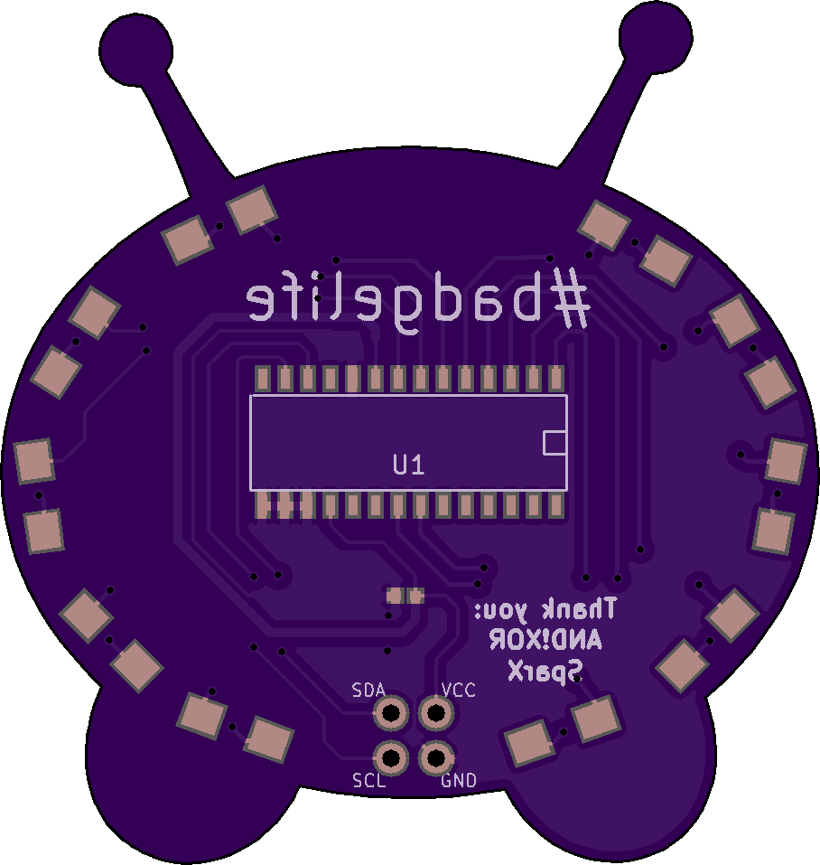

# Mooncake Shitty Addon

A #badgelife shitty addon PCB inspired by Mooncake from Final Space, designed for DEF CON 26.

Created by @d4rkwyng. Thanks to [AND!XOR](https://www.andnxor.com/) and SparX for their help with this project.

## Preview

| Front | Back |
|:-:|:-:|
|  |  |

## Bill of Materials

| Ref | Component | Package | Qty |
|-----|-----------|---------|-----|
| U1 | MCP23017 (Rev C: MCP23017-E/SO; Rev C ESO: MCP23017-E/SS) | Rev C: SOIC-28 (1.27 mm pitch); Rev C ESO: SSOP-28 (0.65 mm pitch) | 1 |
| D1-D10 | LED | 1206 | 10 |
| R1-R10 | 220 ohm | 1206 | 10 |
| C1 | 0.1uF | 1206 | 1 |
| X1 | Shitty connector | 2x2 | 1 |

## Revisions

- **Rev C** — Final revision. `mooncake_RevC_ESO` is a variant of the same board whose U1 footprint is the SSOP-28 MCP23017-E/SS (`lib/MCP23017-ESS_NoSilk`), not the SOIC-28 used on plain Rev C; order the matching chip for the gerbers you fab
- **Rev B** — Updated layout and routing
- **Rev A** — Initial prototype

## Project Structure

```
mooncake-addon/
├── design/          # Artwork, silkscreen, and soldermask KiCad footprints
├── gerbers/         # Manufacturing files (Rev B, C, and C ESO)
├── lib/             # KiCad component libraries
└── mooncake_*       # Schematic, PCB, and netlist files
```

## Tools

- [KiCad](https://www.kicad.org/) — Schematic and PCB design

## License

MIT License. See [LICENSE](LICENSE) file.
